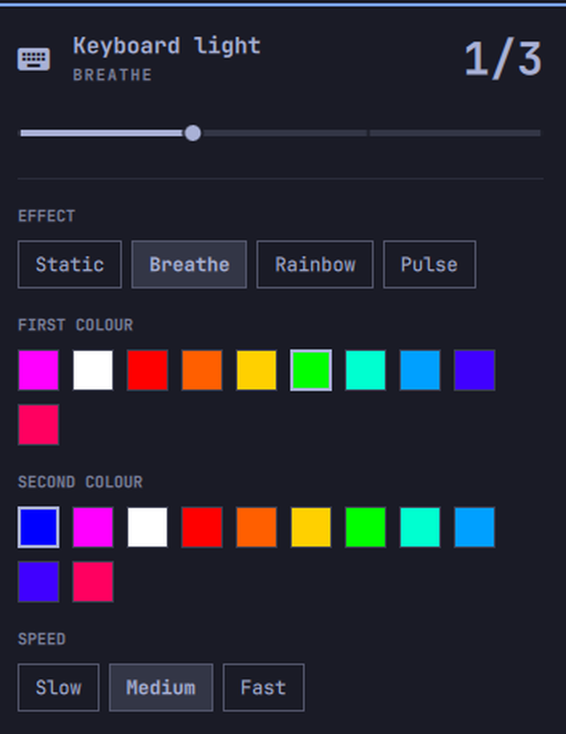

# Asus TUF/ROG Keyboard Light

Control the ASUS keyboard backlight from the Omarchy bar — brightness, effect,
colour and speed, without leaving the desktop or reaching for `sudo`.



## What it does

Two independent pieces of hardware sit behind one bar icon:

- **Brightness** is a plain kernel LED (`/sys/class/leds/asus::kbd_backlight`),
  driven through `brightnessctl`, which reaches it via logind's D-Bus. No root,
  no udev rule.
- **Colour and effect** are the Aura controller, driven by `asusd`. `asusctl`
  talks to the daemon over D-Bus with polkit. Again no root.

Both can also be changed behind the widget's back — the Fn keys move
brightness, `rog-control-center` and `omarchy theme set` move the colour — so
the widget reads the real state back instead of trusting its own last write.

If `asusd` is not installed or not running, the widget degrades to a
brightness-only control and says so in the panel. It does not break.

## Requirements

| | |
|---|---|
| **Omarchy** | 4.x (the Quickshell `omarchy-shell`) |
| **Hardware** | An ASUS laptop exposing `/sys/class/leds/asus::kbd_backlight` |
| **Brightness** | `brightnessctl` |
| **Colour + effects** *(optional)* | `asusctl` with the `asusd` service running |

Check your hardware before installing:

```bash
cat /sys/class/leds/asus::kbd_backlight/max_brightness   # a number = supported
systemctl is-active asusd                                # active = colour available
```

With `hideWhenUnsupported` left on (the default), the widget simply hides
itself on machines with no keyboard backlight, so it is harmless in a shared
config.

## Install

```bash
omarchy plugin add https://github.com/samara-hub-ro/samara-tuf-keyboard-light.git --enable --yes
```

Plugins run as unsandboxed code inside `omarchy-shell`. Drop `--enable --yes`
to review the source before enabling it:

```bash
omarchy plugin add https://github.com/samara-hub-ro/samara-tuf-keyboard-light.git
# review ~/.config/omarchy/plugins/samara-hub-ro.keyboard-light/
omarchy plugin enable samara-hub-ro.keyboard-light
```

It lands in the bar's right section. Move it with:

```bash
omarchy bar move samara-hub-ro.keyboard-light --section center
```

Updating and removal are the usual commands:

```bash
omarchy plugin update samara-hub-ro.keyboard-light
omarchy plugin remove samara-hub-ro.keyboard-light
```

> **Bar widgets need a full shell restart to re-instantiate.**
> `omarchy-shell shell rescanPlugins` reloads plugin *code*, but live bar
> widgets keep their existing instances. After installing or hacking on this
> plugin, run `omarchy restart shell` if the bar looks unchanged.

## Using it

**Bar icon**

| Action | Result |
|---|---|
| Left click | Open / close the panel |
| Right click | Toggle the light off, or back to its last level |
| Scroll | Step brightness up and down (disable with `scrollToAdjust`) |

The icon dims while the light is off, and its tooltip carries the current
level. It keeps following the hardware even when the panel is shut, so Fn-key
changes show up there too.

**Panel**

- **Brightness** — slider across the LED's real range (0..`max_brightness`,
  typically 0..3). Right-click the slider to toggle.
- **Effect** — Static, Breathe, Rainbow, Pulse. Each effect carries its own
  colours in `asusd`'s config, so switching back and forth does not overwrite
  them.
- **Colour** — presets, with your **active Omarchy theme's keyboard colour
  first** when the theme ships one, so the keyboard can be matched to the
  desktop in one click. Breathe shows a second colour to fade towards.
- **Speed** — for Breathe and Rainbow.

**Keyboard**, while the panel is open: `←`/`→` step brightness, `Enter`
toggles the light, `Tab` moves to the neighbouring panel, `Esc` closes.

## Settings

Configured per bar entry in `~/.config/omarchy/shell.json`, or through
Omarchy's plugin settings UI, which builds a form from the manifest schema.

| Key | Type | Default | What it does |
|---|---|---|---|
| `scrollToAdjust` | boolean | `true` | Scroll the bar icon to change brightness without opening the panel |
| `hideWhenUnsupported` | boolean | `true` | Conceal the widget when no keyboard backlight device is present |
| `speed` | `Low` / `Med` / `High` | `Med` | Animation speed for Breathe and Rainbow |

```jsonc
{
  "id": "samara-hub-ro.keyboard-light",
  "scrollToAdjust": false,
  "speed": "High"
}
```

`speed` lives here rather than being read back from `asusd`, because `asusd`
accepts the speed argument but persists `Med` to its own config regardless —
reading it back would snap the control to Medium after every change.

## How it reads state

`asusd` names its Aura config after the hardware it detected: `aura_tuf.ron`
on a TUF, `aura_laptop.ron` elsewhere, plus `aura_anime.ron` / `aura_slash.ron`
variants that drive auxiliary displays rather than the keyboard. The widget
probes for the right one at startup instead of assuming a filename, and
re-probes when the panel opens, so it also works if `asusd` starts after the
shell.

That config is RON. Rather than pull in a parser, the widget walks the
parentheses of each effect block and picks the fields out with regexes — the
shapes involved are fixed and shallow.

Neither sysfs LED attributes nor `asusd`'s config deliver usable inotify events
(`asusd` rewrites atomically, replacing the inode), so both are polled: every
second while the panel is open, every five seconds while it is shut, and not at
all on hardware with no backlight.

## Troubleshooting

**The widget is not in the bar.** Confirm it is enabled and placed:
`omarchy plugin list | grep keyboard-light`. Then `omarchy restart shell` —
`rescanPlugins` alone will not re-instantiate a bar widget.

**The icon is missing but the plugin is enabled.** With `hideWhenUnsupported`
on, no `/sys/class/leds/asus::kbd_backlight` means no icon. Set it to `false`
to make the widget visible and see the fallback text.

**Only brightness shows, no colour or effects.** `asusd` is not running, or it
wrote no keyboard Aura config. Check `systemctl is-active asusd` and
`ls /etc/asusd/aura_*.ron`.

**Brightness does not move.** Test the underlying command directly:
`brightnessctl -d asus::kbd_backlight set 2`.

**Colour does not change.** Test `asusctl aura effect static -c ff0000`. A
polkit prompt or a D-Bus error here is an `asusctl` setup issue, not a widget
one.

## Compatibility

Developed and tested on an ASUS TUF laptop under Omarchy 4. The Aura config
path is auto-detected rather than hardcoded, so other ASUS models should work,
but they are untested — reports welcome.

## License

MIT. See [LICENSE](LICENSE).
